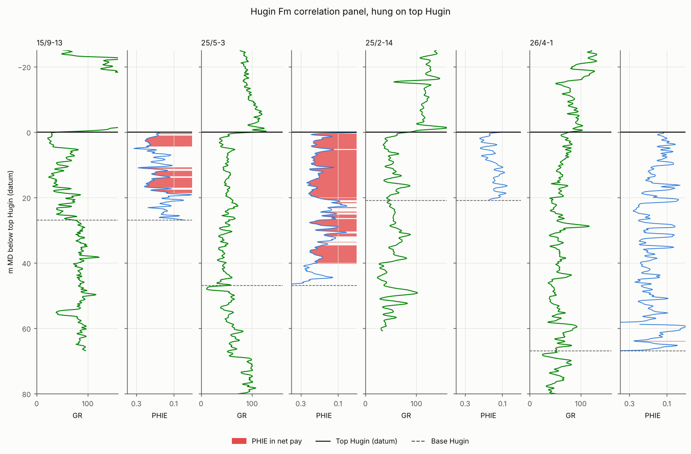

# Hugin Formation evaluation from FORCE 2020 well logs

Formation evaluation of the Middle Jurassic **Hugin Formation** in four wells from the public
**FORCE 2020** dataset (Norwegian Continental Shelf): raw logs to shale volume, porosity, water
saturation and net pay, with a **Monte Carlo P90/P50/P10** on every result, a cutoff sensitivity
sweep, and checks against the FORCE expert lithology picks and published Hugin porosity.

This is a portfolio study of 4 wells on public data. It is not industry work and not a field-wide
study. The logs, their light cleaning, the NPD formation labels and the lithology labels come from
FORCE 2020; the interpretation is this repository's own and is kept separate from theirs.

## Results

Base case (full write-up with per-well notes, uncertainty, QC and validation: **[results/SUMMARY.md](results/SUMMARY.md)**):

| Well | Hugin gross (m MD) | Net pay (m), P90 / P50 / P10 | Avg PHIE in net | Avg Sw in pay | Reading |
|---|---|---|---|---|---|
| 15/9-13 | 26.9 | 10.2 / 11.2 / 12.8 | 0.195 | 0.36 | hydrocarbons in upper and middle Hugin, light-HC crossover |
| 25/5-3 | 46.8 | 30.6 / 33.2 / 35.9 | 0.205 | 0.27 | hydrocarbons over a 2424-2426 m MD contact, water leg below |
| 25/2-14 | 20.8 | 0 / 0 / 0 | 0.156 | - | water-bearing |
| 26/4-1 | 66.9 | 0 / 0.3 / 0.5 | 0.195 | - | water-bearing (0.3 m flag is a thin shaly bed) |

- Lithology from logs agrees with the FORCE hand picks on **78 %** of Hugin samples; the
  disagreements (cemented stringers, shaly sand vs shale) are explained in the summary.
- Net pay moves most with the **Sw cutoff** and, in the Monte Carlo, with **Rw** and the **GR shale
  baseline**.
- **Core plugs (405 helium porosities in the four wells):** in clean sand the logs agree with core
  to within 0.025 on average (PHIT +0.024, PHIE -0.008). Core sits between PHIT and PHIE; PHIT reads
  high and PHIE low as Vsh rises, and in 25/5-3 the GR-based shale correction overshoots, which
  makes that well's pay estimate conservative. Nothing was re-tuned to the core.
- 15/9-13 average porosity (0.195) sits inside the 0.18-0.24 log porosity range published for the
  nearby Volve Hugin reservoir (Otoo & Hodgetts 2021).



## Run it

```bash
conda env create -f environment.yml && conda activate hugin-petro   # or: pip install -r requirements.txt
make data      # FORCE 2020 logs, ~170 MB, md5-verified into data/raw/ (never committed)
make core      # core plugs from Zenodo (or: python scripts/fetch_data.py --core-file PATH, md5-checked)
make run       # steps 1-11 -> results/ and results/SUMMARY.md
make test
```

The pipeline is deterministic (fixed Monte Carlo seed) and takes about a minute; the first run with
the core file adds ~2 minutes to parse the 76 MB spreadsheet (cached afterwards).

## Workflow

| Step | Module | Output |
|---|---|---|
| 1 Load + inventory (format sniffed, not assumed) | `hugin/io.py`, `hugin/inventory.py` | `01_inventory_hugin_wells.csv` |
| 2 QC: bad hole, spikes, ranges, LAS units, depth alignment | `hugin/qc.py` | `02_qc_*.csv` (every masked interval logged) |
| 3 Tops from NPD labels, checked against the GR break | `hugin/tops.py` | `03_tops_check.csv`, `figures/tops_*.png` |
| 4 Lithology from density-neutron + Vsh, confusion table vs FORCE | `hugin/lithology.py` | `04_lithology_*.csv`, `figures/dn_crossplot_*.png` |
| 5 Vsh: GR index + Larionov (older rocks) | `hugin/petro.py` | `08_curves_hugin.csv` |
| 6 Porosity: density, density-neutron, shale-corrected PHIE | `hugin/petro.py` | |
| 7 Sw: Pickett-derived Rw, Archie and Simandoux | `hugin/petro.py`, `hugin/evaluation.py` | `figures/pickett_*.png`, `07_rw_regional_check.csv` |
| 8 Cutoffs, net pay, cutoff sweep | `hugin/evaluation.py` | `08_base_case_summary.csv`, `08_cutoff_sweep.csv` |
| 9 Monte Carlo P90/P50/P10 | `hugin/uncertainty.py` | `09_monte_carlo_*.csv`, `figures/monte_carlo.png` |
| 10 Validation: core plugs (with depth-shift search), published values | `hugin/validation.py`, `hugin/core.py` | `10_*.csv` |
| 11 Composite logs, correlation panel, summary | `hugin/plots.py`, `hugin/report.py` | `figures/composite_*.png`, `SUMMARY.md` |

Every parameter (a, m, n, Rw source, matrix and fluid density, GR baselines, cutoffs, Monte Carlo
ranges) is in [`hugin/config.py`](hugin/config.py) with the reason for it; assumptions are labelled
as such. The method choices are explained in [docs/METHODS.md](docs/METHODS.md).

## Data and credits

- **FORCE 2020 well log and lithofacies dataset**: Bormann P., Aursand P., Dilib F., Manral S.,
  Dischington P. (2020), doi:[10.5281/zenodo.4351156](https://doi.org/10.5281/zenodo.4351156), and
  the competition repository https://github.com/bolgebrygg/Force-2020-Machine-Learning-competition.
  CC BY 4.0; original well data from the Norwegian government under NOLD 2.0. `scripts/fetch_data.py`
  downloads the competition CSVs and LAS files pinned to commit `c8d01ee`.
- **Norwegian core data (RealPore)**: porosity, permeability and rock type from 1,240 wells,
  GeoProvider and Bormann P., doi:[10.5281/zenodo.4419060](https://doi.org/10.5281/zenodo.4419060),
  CC BY 4.0. Data made available through sponsorship by GeoProvider, https://geoprovider.no/ (acknowledgement required by the licence).
- Published comparison: Otoo D., Hodgetts D. (2021), Geosci. Model Dev. 14, 2075-2095,
  doi:10.5194/gmd-14-2075-2021.

Raw data is never committed; `data/` is git-ignored.
